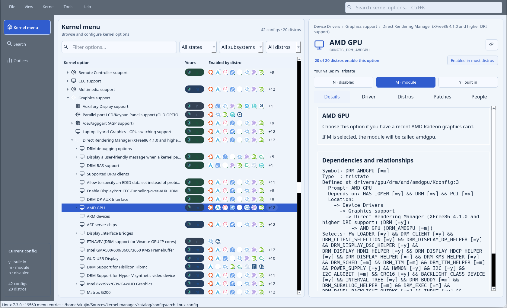
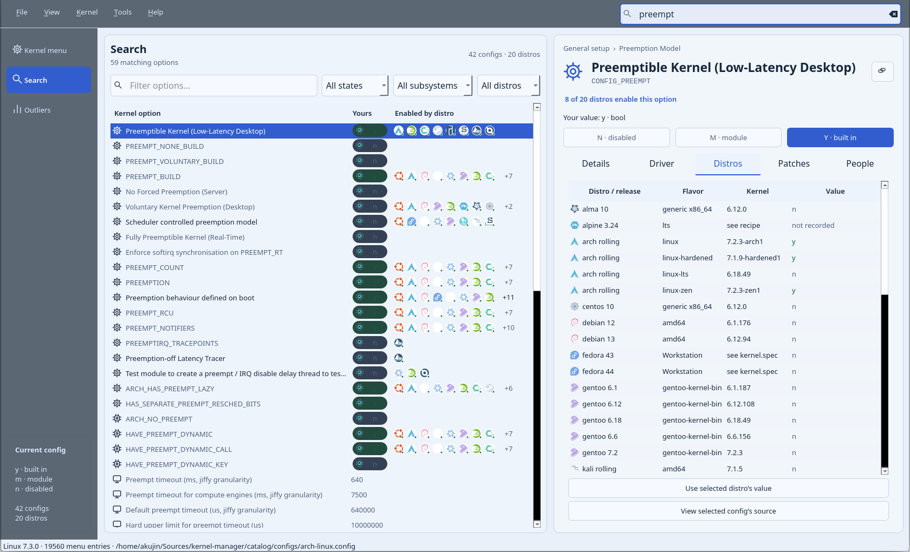

# Kernel Manager

Explore, compare, and configure Linux kernels in a native Qt 6 desktop app.

Kernel Manager puts the Kconfig menu, dependency explanations, distribution configs, and downstream patches in one place. Find an unfamiliar option, see how other distributions configure it, and prepare a working config for your own kernel. Changes are resolved by the Linux source tree's **native Kconfig C engine**.



*The kernel browser with `CONFIG_DRM_AMDGPU` selected. Distribution icons show where each option is enabled; the detail pane explains its meaning and dependencies.*

## What you can do

- **Browse and edit Kconfig.** Navigate the kernel's menu hierarchy, inspect dependencies, and set built-in, module, disabled, or scalar values within Kconfig's constraints.
- **Search beyond symbol names.** Search full help text, quoted phrases, and menu paths. Narrow a view by config value, subsystem, or distribution.
- **Compare distribution choices.** Inspect each release's recorded value and source, load a complete distro profile, or apply one distro's value to the current option. Outliers finds options disabled in your config but enabled elsewhere.
- **Investigate drivers.** Connect options with local PCI/USB devices, bound modules, source files, MAINTAINERS entries, and Git history where available.
- **Explore downstream patches.** Read patches and their provenance, find patches related to an option, and check whether a patch applies to a selected source tree.
- **Prepare kernel experiments.** Export a separate config or defconfig, create a private build workspace, and inspect engineering views for kernel maintenance, Apple Silicon, and desktop/handheld work.



*Search for `preempt`, then open Distros to compare preemption settings. These screenshots use the Paper palette, Linux 7.3.0, and the bundled Arch profile in an x86_64 session.*

## Build and run

### Requirements

| Dependency | Purpose |
| --- | --- |
| Linux and a complete Linux source tree | Supplies Kconfig definitions and the native engine; installed kernel headers alone are insufficient |
| CMake 3.24+, a C11/C++20 compiler, Flex, and Bison | Builds the application and Kconfig parser |
| Qt 6.4+ Widgets, Network, and Svg development libraries | Desktop interface and backend communication |
| Ninja | Build tool used in the commands below; another CMake generator also works |
| KDE Frameworks 6 WindowSystem development library, optional | Enables backdrop blur on supported compositors |

Python 3 and Git support patch and build tools. Kernel builds additionally need Bubblewrap and the selected kernel's build dependencies. Catalog collectors use Python 3, Git, `zstd`, and `xz`, depending on the source being collected.

From the project directory:

```sh
cmake -S . -B build -G Ninja -DKERNEL_SOURCE=/usr/src/linux
cmake --build build --parallel 6
./build/kernel-manager --kernel /usr/src/linux
```

Set both source paths to your Linux checkout if it lives elsewhere. The app opens the source tree's `.config` when available, falling back to its architecture's default config. To open a specific config:

```sh
./build/kernel-manager --kernel /usr/src/linux --config /path/to/your.config
```

Or start with a bundled profile:

```sh
./build/kernel-manager --kernel /usr/src/linux --copy-profile arch-linux
```

The default build type is `MinSizeRel`. Kconfig's C API changes between kernel releases, so rebuild against the source engine you intend to use. A clean build has been checked with Qt 6.11.1 and Linux 7.3.0. Run from the built checkout for now: resource lookup still uses project paths, and a relocatable installation is unfinished.

## Using the app

1. **Choose your starting point.** Open a config with **File → Open Config**, or choose **File → Load Distribution Config**. **Kernel → Source / Target** opens a session for a different source tree or architecture.
2. **Find an option.** Browse the Kernel menu, press **Ctrl+K** to search, or select Outliers. The filters above the list narrow it without losing the menu ancestry.
3. **Inspect the evidence.** Details shows help and dependencies; Driver shows hardware and source context; Distros compares recorded values; Patches and People provide related patches and attribution.
4. **Make a working copy.** Edit values in memory, then use **File → Save As** or **Export Minimal Defconfig** to write a separate file.

### Search syntax

Search is case-insensitive, and all query terms must match. Symbol matches rank ahead of help-text matches. A `CONFIG_` prefix is optional.

| Query | Finds |
| --- | --- |
| `DRM_AMDGPU` | The AMD GPU option and related mentions |
| `"power management"` | The phrase in searchable option text |
| `name:PREEMPT` | Symbols whose names contain `PREEMPT` |
| `help:"power management"` | The phrase in Kconfig help |
| `path:"File systems"` | Options under that menu path |

**View** offers Paper, Slate, High contrast, and Menuconfig palettes, adjustable text size, and side-by-side or stacked layouts. Panels are translucent; KDE backdrop blur depends on compositor support. **F1** lists keyboard shortcuts.

### Configs and build workspaces

Opening a config reads it into memory. Kconfig's dependency and toolchain normalization does not count as a user edit. Imported configs, the selected source tree, the bundled catalog, `/usr/src`, `/boot`, and installed module directories are protected from save operations. Save As and export require a writable destination in an existing directory.

**Kernel → Build Workspace** prepares a separate source copy. Patch stacks are checked cumulatively in a disposable copy before being applied as a whole, with the previous source retained. Kernel build commands run through Bubblewrap with the host filesystem read-only and the workspace writable. The app has no kernel installation, bootloader, reboot, or privilege-elevation commands.

### ARM64 and Apple Silicon

Select `arm64` and a matching source tree. LLVM is the default toolchain for ARM64 configuration:

```sh
./build/kernel-manager --kernel /path/to/asahi-linux \
  --arch arm64 --toolchain llvm --copy-profile asahi-arm64
```

The catalog includes an Asahi ALARM config. Downstream symbols such as `DRM_ASAHI` require a source tree that defines them; an upstream tree reports missing options. **Tools → Engineering Workbench** groups relevant options and provides a source browser for device trees, bindings, graphics, power, firmware, and build documentation.

## Command-line use

The same executable provides JSON reports without starting a GUI. `--kernel`, `--config`, `--copy-profile`, `--arch`, and `--toolchain` select the inputs for these commands.

```sh
# Discover the bundled profiles.
./build/kernel-manager --list-profiles

# Inspect an option or search its help text.
./build/kernel-manager --symbol DRM_AMDGPU
./build/kernel-manager --search 'help:"power management"'

# Compare your config and inspect local hardware evidence.
./build/kernel-manager --outliers
./build/kernel-manager --machine

# Get an engineering report or workload suggestions.
./build/kernel-manager --workbench valve
./build/kernel-manager --suggestions 'Gaming / low latency'
```

`--set` is repeatable and requires `--export`. For example, write an experimental config to a new file in the current project directory:

```sh
./build/kernel-manager --kernel /usr/src/linux \
  --copy-profile arch-linux \
  --set LOCALVERSION=-experiment --export "$PWD/experiment.config"
```

Exports use the same dependency resolution and destination checks as the desktop. To check a patch against a source tree without applying it:

```sh
python3 tools/kernel_work.py check \
  --source /usr/src/linux --patch /path/to/change.patch
```

Run `./build/kernel-manager --help` for all options.

## Distribution catalog

The bundled snapshot contains **44 configs across 21 distribution families and 929 patch records**, including Arch, Debian, Ubuntu, Fedora, Gentoo, NixOS, SteamOS, and Asahi. Comparisons use the session's target architecture: the x86_64 screenshots show 42 configs from 20 families. See [catalog coverage](catalog/COVERAGE.md) for every profile, input kind, and original source.

| Recorded value | Meaning |
| --- | --- |
| `y` | Built in |
| `m` | Module |
| `n` | Explicitly disabled |
| not recorded | Absent from that input; its value is unknown |

Distribution counts deduplicate releases within each family. Config fragments and build inputs keep their labels; they are not silently treated as complete, normalized configs. A distro enabling an option is evidence about its build, not proof that it supports your hardware or improves your workload.

Config bytes are SHA-256 checked on load. [The catalog index](catalog/index.json) retains source URLs, hashes, package members, revisions, and available patch attribution and base information. A successful patch check establishes applicability to that particular tree, not runtime correctness or compatibility with another patch stack.

### Refresh the catalog

The bundled catalog is ready to browse. To update it, run the relevant collectors from the project directory:

```sh
python3 tools/collect.py
python3 tools/collect_extra.py steamos nixos patches
python3 tools/collect_more.py
python3 tools/collect_advanced.py
python3 tools/steam_patches.py
```

Collectors download public config, package, and patch material without installing packages or executing distribution packaging scripts. They report collection failures. Downloads are cached in `catalog/cache`; source archives, especially Valve's GPL Git archive, can consume several GiB.

## Development status

Kernel Manager is version 0.1.0. The configuration browser, distro comparisons, patch inspection, and JSON CLI are implemented. Build workspaces and ARM64 targeting are implemented but still need end-to-end validation; the application build check above is not a kernel-build validation.

Hardware mapping uses direct kernel Makefile assignments and can miss composite modules or produce ambiguous matches for generic names. Workload suggestions are an initial rule set that needs review, not a benchmarked optimizer. Patch coverage is incomplete. Config migration reports, measured experiment comparisons, firmware inventory, and installation support remain future work.

The desktop uses Qt Widgets item models and a separate Kconfig backend process. Catalog loading, search, source reads, and permission checks run outside the UI process; driver and patch details load on demand. For implementation details, see [the event-bus design](docs/EVENT_BUS.md) and [memory design and measurements](docs/MEMORY.md).

## License

Application code is [GPL-2.0-only](LICENSE), consistent with the Linux Kconfig engine it links. Collected configs and patches retain their original terms. Distribution logo provenance and licenses are recorded in [assets/distro/sources.json](assets/distro/sources.json), with [Nobara's accompanying notice](assets/distro/NOBARA-COPYING). Logos do not imply endorsement.
