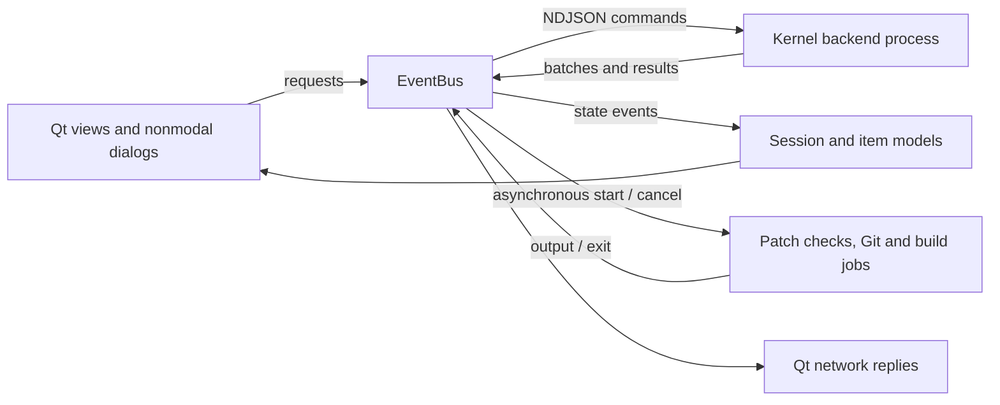

# Event-driven desktop architecture

The desktop creates its window before loading the catalog or parsing Kconfig. It
renders a cached `Session` through Qt item models. Requests and publications pass
through `EventBus`; widgets never call the kernel engine, scan directories, read
source text, check permissions, or wait for child processes themselves.



## Ownership and ordering

- `backend.cpp` owns one `Engine`, catalog and lazy hardware/source index. Kconfig
  has process-global state, changes the working directory and environment, runs
  compiler probes and can exit from parser errors. A separate process isolates
  those effects from the desktop. Kconfig operations stay serialized.
- `eventbus.cpp` owns the backend, independent job processes and network replies.
  It assigns request IDs, correlates results and disconnects subscriptions when
  their owning view disappears or the request reaches a terminal state.
- `session.cpp` consumes metadata and entry batches. `menumodel.cpp` provides
  stable menu identity and flat search/outlier projections without constructing a
  widget for every kernel option. Logos come from embedded Qt resources.
- `asyncui.cpp` implements nonmodal file selection using backend directory
  requests and paged source previews. Neither file selection nor export dialogs
  introduce nested event loops. The desktop uses only its normal application
  event loop; the worker has its own normal event loop.
- External web/email links also go through the backend, which launches the
  desktop's URL handler independently. Qt text views do not load clicked paths
  or invoke desktop services synchronously.

Requests use newline-delimited JSON, with IDs encoded as strings to preserve
64-bit precision:

```json
{"id":"42","topic":"search","payload":{"query":"help:\"power management\""}}
```

A dispatched operation produces `started`, optional data/progress publications,
then `completed`, `failed` or `cancelled`. Start delivery precedes results. Queue
rejections and cancellation before dispatch return a terminal event without a start.
Backend results carry the originating ID; configuration-dependent results carry a
revision where needed. Search, selection and view-specific lookups use replacement
keys: queued older reads are removed and replies to an already executing obsolete
read are suppressed. Configuration mutations have no replacement key.

The session receives `state-loading`, `metadata`, batches of `entries`, then
`state-ready`. Browsing cached rows remains possible during ingestion; editing
controls stay disabled until the new state finishes arriving. This is an
incremental projection, not an atomic replacement of the entire model.

## Responsiveness and bounds

The bus alternates local publications and backend input so build output cannot
starve kernel replies. It drains against a **soft four-millisecond budget** before
yielding to the Qt event loop. This limits accumulated delivery work; it is not a
hard real-time guarantee for an individual Qt layout/paint callback.

| Work | Bound / policy |
| --- | --- |
| Queued backend requests | 128; overload returns an explicit failure |
| Backend request execution | Two-minute asynchronous deadline; failure stops the backend and disables mutation controls |
| Snapshot/search/path batches | Up to 128 entries |
| Catalog patch batches | Up to 16 records |
| Directory chooser | 256 entries per page, in batches of 128 |
| Source/patch text preview | 32 KiB pages, preserving UTF-8 boundaries |
| Job output | 16 KiB byte chunks, with a stateful UTF-8 decoder |
| Pending display output per job | 1,048,576 UTF-16 code units; older queued output may be skipped with an explicit truncation event |
| Job log widget | 3,000 blocks and approximately 512 KiB characters, plus the incoming chunk |
| Concurrent job processes | 8 |
| Upstream attribution request | 20-second transfer timeout; 1 MiB response limit |
| Backend input buffered in GUI | 32 MiB; malformed/oversized input fails the backend |

Full compiler output is kept by the build worker in the workspace's `build.log`.
Consumers of structured process output reject truncated results rather than
claiming a patch applies cleanly or presenting incomplete blame as complete.
Diagnostic display events are coalesced. Maintainer filename patterns use native
`fnmatch` with cached UTF-8 patterns; context keeps at most 64 option records.
Patch matching streams 64 KiB reads and caches at most 512 KiB of match indices
and accounting overhead. It does not retain whole diffs. See [memory design](MEMORY.md).

The GUI requests `select` with `details: false` for the description and distro
values. Driver/device and People tabs request `context`; Patches requests
`related`. All use selection IDs and revision checks. The legacy full `select`
response remains available for protocol callers. Tree filters use `filter-options`
and return matching ancestors in 128-index batches; flat search and outliers
accept the same text/state/subsystem/distro fields.

## Cancellation and shutdown

Closing a view unsubscribes its listeners and cancels its replaceable reads,
network requests and owned jobs. Cancelling an executing Kconfig read invalidates
its reply; it does not interrupt native parser state. Explicit mutations already
accepted by the backend remain serialized. There is no automatic mutation retry.

Independent jobs have their own process groups. Cancellation sends SIGTERM and
schedules SIGKILL after three seconds if the process still runs. A job process is
owned by the application until it exits, even if its dialog has closed. Application
shutdown follows the same asynchronous path and quits the event loop after its
owned processes and network replies have stopped. No GUI destructor calls
`waitForFinished`, `waitForStarted`, a thread join or a nested dialog `exec`.

A backend failure rejects outstanding and subsequent requests. Cached browsing
remains available, but resolving/editing requires a new app session. Unsaved
in-memory changes are not recovered automatically after a backend failure.

## Permission and source protection

Permission requests are read-only. Save/export/workspace controls stay disabled
while checks are pending and show the returned reason. The worker checks the
destination again when executing an explicit write. Source configs and protected
kernel paths remain reference inputs; builds and patch transactions use the
existing isolated workspace workflow. No elevation or installation path is added.

## Verification

The refactor was compiled against Qt 6.11 and the local Linux 7.0.3 Kconfig engine.
A headless worker protocol exercise covered initialization, search, selection,
outliers, directory/source browsing, patch search, engineering/internals reports,
permission checks, invalid requests and an in-memory edit. The source `.config`
hash remained unchanged. Desktop interaction and cancellation latency have not
been measured in this pass; the user's desktop app was not relaunched.

The existing synchronous JSON CLI remains available for shell use. This change
does not create a test suite or claim an end-to-end kernel build was performed.

Qt's [process signals](https://doc.qt.io/qt-6/qprocess.html) and
[asynchronous dialog guidance](https://doc.qt.io/qt-6/qdialog.html) document the
underlying event-loop APIs.
